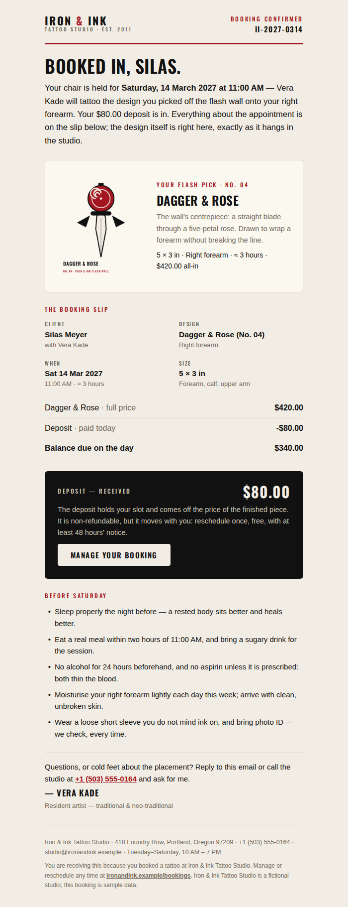
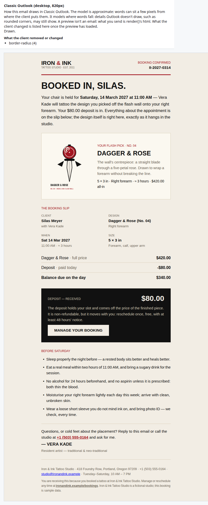
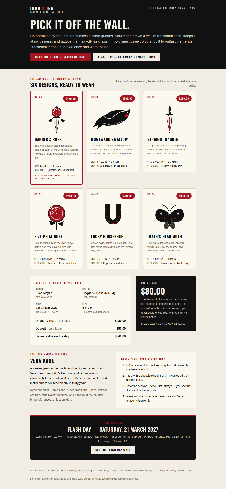
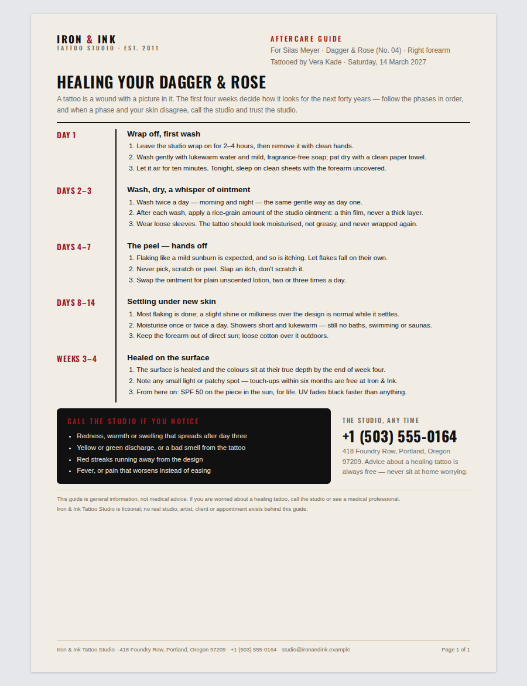
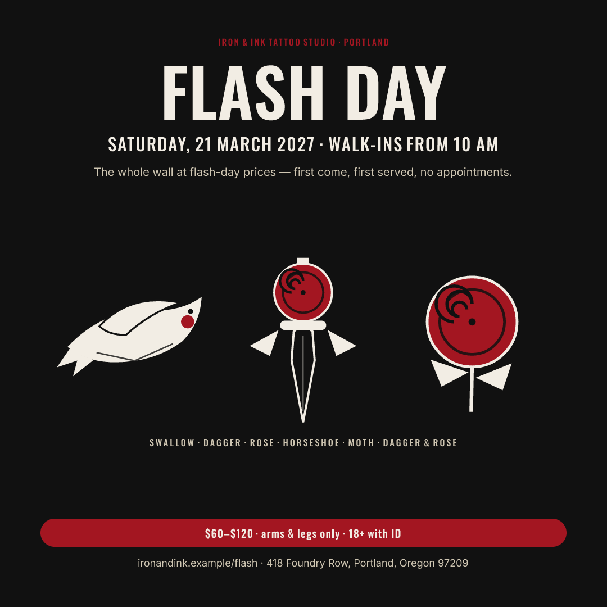

# Iron & Ink — a tattoo studio template

A working flash wall for a fictional Portland tattoo studio: clients pick a
drawing off the wall, pay a deposit, sit for the piece, and leave with a
printed sheet that tells them how to heal it.


## The flash-sheet engine

Most studio templates start from pages and pour content into them. This one
starts from the wall. `src/data.ts` holds a **flash catalogue** — six designs,
each with a catalogue number, a working size, placement notes, a session
length and a price — and `src/flash.tsx` holds a **drawing registry** that
turns each catalogue entry into an actual drawing: Svg shapes (a dagger, a
rose, a swallow, a horseshoe, a moth, and the dagger-through-rose
centrepiece), drawn in two tones, ink-on-bone for pale sheets and bone-on-
black for dark panels. A `FlashTile` wraps one entry — drawing, number,
price tag, notes — and `FlashSheet` deals the whole catalogue out as a grid.

Because the drawings live in a registry rather than in any one template,
every appearance of a design is the same drawing: Vera's wall on the page,
Silas's pick inside his confirmation email, three motifs lifted onto the
flash-day poster.

## The four pieces

### The booking email (600px)



Silas Meyer has picked **No. 04, Dagger & Rose**, for his right forearm, and
the email leads with the design itself — drawn, numbered and priced — above
the booking slip, the $80 deposit panel, the run-up checklist Vera sends
every client, and her sign-off. An `Email` cannot hold an `Svg` (the
framework's validator will tell you so, in those words), so the build first
renders the design as a small printed card through the Canvas image engine
and the email carries that PNG. The drawing never changes — only its
delivery format does. The build also writes the email as classic Outlook,
Gmail and Apple Mail render it (`out/clients/`); the Outlook capture:



### The studio page (960px)



The page *is* the wall: a black header band, then the catalogue dealt out as
six flash tiles, with Silas's pick ringed in red and his booking slip
directly underneath it. The artist, the deposit and flash day all follow the
wall — which is how the studio itself works.

### The aftercare guide (A4, one page)



The sheet Vera hands over the counter. Its day-by-day healing timeline is
**generated, not written**: `src/care.tsx` takes care-phase data (a day
range, a title, a list of instructions) and bolts each phase onto a timeline
rail — Day 1, Days 2–3, Days 4–7, Week 2, healed by Weeks 3–4. Add a phase
to the data and the guide grows a step; the current five phases land on
exactly one A4 page, warning panel, studio phone number and all.

### The flash-day card (1080 × 1080)



A poster for the window and the feed: the date set as tall as Oswald goes,
three drawings off the wall in their bone-on-black tone, and the rest of the
wall named underneath.

## How Hyper Elements was used

- **A registry instead of assets.** Every visual in the kit is an `Svg`
  element tree keyed to a catalogue entry — there are no image files in the
  repository at all. The one raster image that exists, the design PNG inside
  the email, is produced at build time by `renderImage()` from a `Canvas`
  holding that same `Svg`, because the Email writer has no inline SVG; the
  validator's own error message prescribes exactly this workaround.
- **Generators over hand-written sections.** `FlashSheet` maps the
  catalogue to tiles; `CareTimeline` maps care phases to a timeline. The
  templates mostly decide *which* generator to run and what to put around
  it — the page's grid and the guide's timeline would survive a complete
  change of designs or phases without a line of layout code changing.
- **One theme, worn four ways.** `src/theme.ts` defines bone `#F2EDE4`,
  black `#111111` and blood red `#A31621` once with `defineTheme()`, along
  with the Oswald/Inter type pairing and named styles (`sheet`,
  `blackPanel`, `eyebrow`, `priceTag`). The palette is also exported as a
  plain object, so the Svg drawings and the theme tokens are literally the
  same colours. An email-specific format override tightens the headings for
  the inbox.
- **Validation as the build gate.** `scripts/build.tsx` runs `validate()`
  on all four templates before rendering anything, with the
  `@hyper-elements/email-clients` plugin attached to the email, and fails
  on any error. The current build reports **0 errors, 0 warnings** on every
  template and every render. (The email-clients plugin adds info-level
  notes — classic Outlook squares the corners and drops the letter-spacing,
  most clients substitute the web fonts — graceful degradations, not
  defects.)
- **Fonts without a network.** Oswald and Inter come from the `@fontsource`
  packages. The PDF and the cards receive them as local WOFF files via
  `src/fonts.ts`; nothing is fetched at build time.

## Run it

```bash
npm install
npm run build        # validate, then render everything into out/
npm run screenshots  # Playwright captures into docs/screenshots/
npm run typecheck    # tsc --noEmit
```

Requires Node 20+. What lands in `out/`:

| File | What it is |
| --- | --- |
| `out/email.html`, `out/email.txt` | The booking confirmation, and its plain-text twin |
| `out/design.png` | Silas's design, rendered for the email |
| `out/page.html` | The flash-wall page |
| `out/aftercare.html`, `out/aftercare.pdf` | The aftercare guide — print HTML and the one-page A4 PDF |
| `out/flash-card.png`, `out/flash-card.svg` | The flash-day card, 1080 × 1080 |
| `out/clients/*.html` | The email as Outlook, Gmail and Apple Mail draw it |

## Make it yours

Redraw the wall: add an entry to `flashCatalogue` in `src/data.ts` and a
drawing under its key in `src/flash.tsx`, and the page grows a tile. Change
which design the booking points at (`booking.designKey`) and the email, the
slip and the guide's header follow. Rewrite the healing in `carePhases` and
the printed guide re-flows. Recolour everything from `palette` in
`src/theme.ts` — the drawings take their colours from the same object.

## Project structure

```
src/
  data.ts      the studio, the catalogue, the booking, the care phases
  flash.tsx    the flash-sheet engine: drawing registry, tiles, the sheet
  care.tsx     the aftercare timeline generator
  studio.tsx   name-plate, booking slip, studio line
  theme.ts     defineTheme(): bone/black/blood, Oswald + Inter, named styles
  fonts.ts     local WOFF files for the PDF and image engines
  email.tsx    booking confirmation (Email, 600px) + the DesignCard canvas
  page.tsx     the flash wall (Page, 960px)
  document.tsx the aftercare guide (Document, A4 portrait)
  canvas.tsx   the flash-day card (Canvas, 1080 x 1080)
scripts/
  build.tsx    design render, validate gate, all renders, client previews
  screenshot.ts Playwright captures for visual checks
docs/screenshots/ captures of every output (+ the Outlook preview)
docs/flash-card.svg  the promo card as SVG, for this README
out/           build outputs (gitignored)
```

## A note on the data

Iron & Ink Tattoo Studio does not exist. Vera Kade and Silas Meyer are
invented, the six designs are drawn for this template, and every price,
date and booking code is sample data — the `.example` domain is reserved
for exactly this. The aftercare instructions are genuine, widely published
practice, but they are general information, not medical advice.

## License

MIT — see [LICENSE](LICENSE). Fonts are under the SIL Open Font License.
